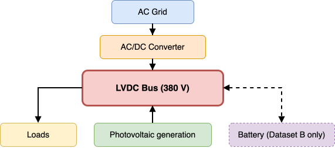

# A real-world LVDC dataset for event-driven monitoring and signal prioritization

<p align="center">
  <a href="https://doi.org/10.5281/zenodo.18524234">
    
  </a>
  
  
</p>

<p align="center">
  
</p>

Real-world time-series measurements from operational low-voltage direct current (LVDC) installations with hybrid AC/DC infrastructure. Data were logged through industrial monitoring interfaces and capture realistic voltage dynamics, measurement noise, and timing irregularities under normal operating conditions.

> Curated as part of the [SHIFT2DC](https://www.shift2dc.eu) Horizon Europe project (Grant Agreement No. 101136131) and described in an accompanying Data Descriptor manuscript.

---

## Datasets

| ID | Installation | Battery | Date | Sampling | Duration |
|----|-------------|---------|------|----------|----------|
| **A** | 380 V hybrid AC/DC | Off (fault condition) | 2025-05-02 | ~1 s | 24 h |
| **B** | 380 V hybrid AC/DC | On (active) | 2024-05-10 | ~1 s | 24 h |
| **C** | 700 V AFE | — | 2025-12-15 | ~0.5 s | Complementary |

Datasets A and B capture the same installation under different battery operating conditions, enabling controlled comparison between **unbuffered** and **buffered** LVDC operation. Dataset C is an independent complementary record from a second industrial partner at a higher voltage level.

Signal descriptions, units, and acquisition context for each dataset are provided in the `metadata/` directory.

---

## Repository structure

```
├── configs/
│   └── datasets.yaml               # Dataset configuration (paths, identifiers)
├── data/
│   ├── raw/                        # Reference CSV datasets used in the manuscript
│   ├── processed/                  # Preprocessed version of Dataset C (column alignment)
│   └── original_from_partners/     # Original files as received, preserved for traceability
├── metadata/                       # Signal descriptions, units, and acquisition context
├── scripts/
│   ├── validation/                 # Reproducible validation pipeline (01–05)
│   ├── reporting/                  # Figure and table generation scripts
│   ├── examples/                   # Standalone example scripts
│   ├── preprocess/                 # Dataset C alignment fix
│   └── common/                     # Shared utilities and I/O configuration
├── figures/                        # Selected figures for documentation and manuscript
│   └── logos/                      # Partner and project logos
├── release/                        # Packaged example scripts for Zenodo release
├── run_all.sh                      # Entry point for the full validation pipeline
├── requirements.txt                # Python dependencies
├── README_ZENODO.md                # Description file included in the Zenodo record
└── CITATION.cff                    # Citation metadata
```

Pipeline outputs are written locally to:

```
out/
├── A/
│   └── YYYY-MM-DD_HHMMZ_<git_hash>/
├── B/
│   └── YYYY-MM-DD_HHMMZ_<git_hash>/
├── C/
│   └── YYYY-MM-DD_HHMMZ_<git_hash>/
└── reporting/
    └── YYYY-MM-DD_HHMMZ_<git_hash>/
```

---

## Quick start

**Install dependencies:**
```bash
pip install -r requirements.txt
```

**Run the full validation pipeline:**
```bash
bash run_all.sh
```

**Run the event detection example:**
```bash
python3 -m scripts.examples.01_event_detection_dvdt \
    --dataset-id A \
    --percentile 99.9 \
    --window-s 30 \
    --plot
```

See `scripts/examples/README_examples.md` for additional usage details.

---

## Data integrity notes

| Dataset | Observation |
|---------|-------------|
| **A** | No duplicated timestamps. ~30.9% of consecutive DC bus voltage samples are identical, consistent with steady-state operation and measurement quantisation. |
| **B** | 1,440 duplicated timestamps (1.67%) occurring systematically at second 54 of each minute, attributed to the logging mechanism. Temporal sequence remains monotonic. |
| **C** | Original log contains structural event markers and a field-order switch after reconnection events. A reproducible alignment script is provided (`scripts/preprocess/01_fix_dataset_C_alignment.py`). The aligned output is stored in `data/processed/`. |

All validation results are reproducible via `scripts/validation/` using `run_all.sh`.

---

## Intended use

- Analysis of LVDC voltage dynamics and event characterisation at the monitoring timescale (1 s)
- Development and benchmarking of event detection methods based on voltage and derived signals (e.g. dV/dt)
- Validation of data-driven models under realistic measurement noise and sampling irregularities
- Comparative studies between buffered and unbuffered LVDC operating conditions

---

## Citation

If you use this dataset, please cite:

```
Arroyo-Valle, F. J., Drexler, K., Roger, S., & Saldaña, J. (2026).
A real-world low-voltage direct current (LVDC) dataset for event-driven
monitoring and signal prioritization. Zenodo.
https://doi.org/10.5281/zenodo.18524234
```

A `CITATION.cff` file is included for reference manager compatibility.

---

## License

Released under [CC BY 4.0](https://creativecommons.org/licenses/by/4.0/). See `LICENSE` for details.

---

## Funding and partners

This work received funding from the European Union's Horizon Europe programme under grant agreement No. 101136131 (SHIFT2DC project).

<p align="left">
  
  
  
  
</p>
